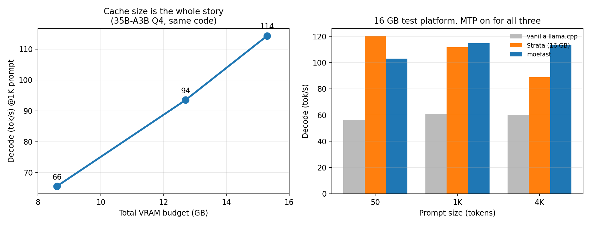

# moefast — run big MoE models on small-VRAM GPUs

`moefast` is a small patch set for [llama.cpp](https://github.com/ggml-org/llama.cpp) that makes
**large Mixture-of-Experts models usable on low-VRAM GPUs** (8 / 12 / 16 GB class) instead of
requiring a 24-48 GB card.

The trick is not to fit the whole model in VRAM. It is to keep **all expert weights in host RAM**
(mmap'd, so the OS can reclaim them) and keep only the **hot experts** in whatever VRAM is left over,
with cold experts computed on the CPU. A routing heat table pre-fills the VRAM cache at startup so
the model is fast from the very first token.



### TL;DR (16 GB test rig, same model, MTP enabled in all three)

| | vanilla llama.cpp | Strata (16 GB) | **moefast** | vs vanilla | vs Strata |
|---|---:|---:|---:|---:|---:|
| Decode @ 1K ctx | 60.7 tok/s | 111.7 | **114.8** | **+89%** | +3% |
| Decode @ 4K ctx | 59.7 tok/s | 89.0 | **113.4** | **+90%** | **+27%** |
| TTFT @ 1K prompt | 1.259 s | 0.723 s | **0.615 s** | **2.0× faster** | **1.2× faster** |
| TTFT @ 4K prompt | 2.186 s | 1.448 s | **1.427 s** | **1.5× faster** | ~equal |

Two things to notice: **the gap to vanilla llama.cpp is ~90% on decode and 2× on latency**, and
**the advantage over a hand-tuned dedicated engine grows with context** (parity at 1K, +27% at 4K)
because the expert cache does not decay as the KV grows. Full tables further down.

**Tried this on a real 8 GB or 12 GB card? Open an issue with your numbers** — we will add
them to the table (our scaling numbers come from capping the cache, not from real small cards).

Written against Qwen3.6-35B-A3B (35.5B total / 3B active, 40 layers, 256 experts, top-8), which is a
good worst case: **18.3 GB of expert weights on a 16 GB card**, with 2.5 GB of dense weights and a
3.3 GB KV cache (200K context) competing for the same memory.

---

## When this helps

| Your GPU | Total model | Dense part | Experts | What moefast does |
|---|---|---|---|---|
| 8 GB | 35B MoE, Q4 | 2.5 GB | 18.3 GB | small cache (2-3 GB), most experts on CPU |
| 12 GB | same | 2.5 GB | 18.3 GB | ~5 GB cache |
| **16 GB (our test rig)** | same | 2.5 GB | 18.3 GB | **7-10 GB cache** |
| 24 GB | same | 2.5 GB | 18.3 GB | 14-18 GB cache, most experts resident |

### Measured scaling with the VRAM budget

Same model, same code, same 16 GB test platform — the VRAM budget is capped via
`--moe-cache-mib` to emulate smaller cards, which isolates the effect of the cache size itself:

| VRAM budget (dense + KV + cache) | Cache | Decode @1K prompt | TTFT @1K |
|---|---:|---:|---:|
| ~8.6 GB → 8 GB-class card | 4.5 GB | 65.6 tok/s | 0.87 s |
| ~12.7 GB → 12 GB-class card | 8.5 GB | 93.5 tok/s | 0.60 s |
| ~15.3 GB → 16 GB-class card | 11.0 GB | 114.3 tok/s | 0.48 s |

Decode goes up **~45%** from an 8 GB budget to a 12 GB budget, and another ~22% from 12 GB to 16 GB —
the cache is the whole story. If you plan for an 8 or 12 GB card, size the cache from the same
budget rule and expect exactly these steps.

It is not magic: the model still has to *run*, so you need enough host RAM for the non-resident
experts (≈ model size) and a CPU with decent memory bandwidth. What changes is that VRAM stops being
the hard limit.

---

## How it works

| Piece | What it does | Source |
|---|---|---|
| **MoE expert cache** | keeps host-resident experts in VRAM in an LRU set; cache hits run on the GPU, misses run on the CPU — nothing is copied per token | llama.cpp upstream (`--moe-cache-mib`, PRs **#29887** / **#30112**) |
| **Auto sizing** `--moe-cache-mib auto` | sizes the cache from *measured free VRAM* after dense weights + KV + compute buffers, leaving a configurable reserve | this patch (`src/llama-context.cpp`) |
| **Reserve knobs** | `LLAMA_MOE_CACHE_MIB` (exact cache size) and `LLAMA_MOE_CACHE_RESERVE_MIB` (always leave N MiB free, e.g. for the desktop / browser / video decode) | this patch |
| **Heat pre-seeding** `LLAMA_EXPERT_HEAT=heat.bin` | preloads the hottest experts per layer at startup, so the first token is already fast instead of waiting for the LRU to learn | this patch (`src/llama-moe-cache.cpp`) |
| **MTP** (optional) | `--spec-type draft-mtp --spec-draft-n-max 3`, if the GGUF has the MTP block | llama.cpp upstream |

Total diff against upstream: **123 lines in 4 files** — see [`patches/moefast.patch`](patches/moefast.patch).

---

## Test environment (a rig, not a requirement)

All numbers below were produced on **one** machine. The point of publishing the config is that you
can reproduce it, not that 16 GB is required:

| | |
|---|---|
| GPU | NVIDIA RTX 5060 Ti **16 GB** (driver 580.126.20, CUDA 13.0) |
| CPU | AMD Ryzen 9 9900X, 24 threads |
| RAM | 30 GB DDR5 |
| OS | Ubuntu 24.04, kernel 7.0.0-38 |
| Model | Qwen3.6-35B-A3B UD-Q4_K_XL (35.5B total, 3B active, 22.84 GB GGUF, MTP block) |

Everything was measured with this project's own llama.cpp build, greedy decoding, `max_tokens=192`,
a fresh prompt per run (no prompt-cache reuse), medians over repeated runs.

---

## Results on the test rig (16 GB)

| Metric | Value |
|---|---|
| Decode, no MTP | 87–89 tok/s (flat from 50 to 4K prompt tokens) |
| Decode, with MTP (`n-max=3`) | **100–103 tok/s** (+15%) |
| TTFT ~50 / ~1K / ~4K tokens | 0.335 s / 0.601 s / 1.239 s |
| Prefill (`-ub 2048`) | 2,270–2,573 tok/s |
| 4.2K context, then decode | 94 tok/s |
| 200K context (KV k8v4, cache 7168 MiB) | 12.6 GB VRAM used, 3.7 GB free, 82 tok/s |
| 2 concurrent requests | 126 tok/s aggregate (1.61×) |

Reference points on the same rig and model:

| Stack | TTFT 50 | TTFT 1K | TTFT 4K | decode 50 | decode 1K | decode 4K |
|---|---:|---:|---:|---:|---:|---:|
| **moefast** | 0.299 s | **0.615 s** | **1.427 s** | 103.1 | **114.8** | **113.4** |
| vanilla llama.cpp (experts on CPU, no cache) | 0.603 s | 1.259 s | 2.186 s | 56.1 | 60.7 | 59.7 |
| Strata (16 GB instance, `--mtp 2`) | **0.166 s** | 0.723 s | 1.448 s | **120.2** | 111.7 | 89.0 |

Takeaway: on tiny prompts a hand-tuned dedicated engine still wins on fixed overhead, but from ~1K
tokens up the cache wins, and it stays flat at 4K while the alternative decays.

---

## Install

Two equivalent ways.

### Option A — ready-to-clone branch (no patching)

```bash
git clone -b feat/moe-cache-main https://github.com/conlododo/llama.cpp
cd llama.cpp
./moefast/install.sh
./moefast/run.sh /path/to/Qwen3.6-35B-A3B-UD-Q4_K_XL.gguf
```

### Option B — apply the patch to your own upstream checkout

```bash
git clone https://github.com/ggml-org/llama.cpp && cd llama.cpp
git checkout 1ba568c                     # the commit this patch is based on
git apply -3 /path/to/moefast/patches/moefast.patch
cp -r /path/to/moefast .
./moefast/install.sh
```

The patch is pinned to upstream `1ba568c` (2026-10-20 master). Upstream moves quickly, so on newer
revisions expect a small conflict — `git apply -3` absorbs most of it; worst case the conflict is in
4 files / ~120 lines.

**Requirements:** CMake ≥ 3.24, CUDA toolkit, C++17 compiler, and enough host RAM to hold the
non-resident experts (≈ GGUF size). Verified on Linux; Windows/ROCm are untested.

---

## Usage

```bash
./moefast/run.sh /path/to/model.gguf [extra llama-server args...]
```

Defaults:

```
-ngl 99 -ot "exps=CPU" -c 8192 -b 2048 -ub 2048 \
--moe-cache-mib auto --fit off --parallel 1
LLAMA_EXPERT_HEAT=moefast/heat/heat_qwen36.bin
```

| Variable | Default | Meaning |
|---|---|---|
| `MOEFAST_PORT` | `8080` | HTTP port |
| `MOEFAST_CTX` | `8192` | context per slot |
| `MOEFAST_PARALLEL` | `1` | concurrent slots |
| `MOEFAST_MTP` | `0` | `>0` enables `draft-mtp` with N drafts |
| `MOEFAST_CACHE_MIB` | `auto` | expert cache: `auto`, `0`, or MiB |
| `MOEFAST_HEAT` | `moefast/heat/heat_qwen36.bin` | heat table |
| `MOEFAST_HOST` | `127.0.0.1` | bind address |

### Sizing the cache to your card (the important knob)

Low-VRAM machines usually need headroom for the desktop, browser, or video decode. Three ways, in
order of precedence:

```bash
# a) exact cache size
LLAMA_MOE_CACHE_MIB=7168 llama-server ... --moe-cache-mib auto

# b) auto, but never eat the last N MiB
LLAMA_MOE_CACHE_RESERVE_MIB=2048 llama-server ... --moe-cache-mib auto

# c) plain upstream behaviour
llama-server ... --moe-cache-mib 7168
```

Measured on the 16 GB rig (200K ctx, KV k8v4):

| Cache | VRAM used | Left for the system | decode |
|---|---:|---:|---:|
| auto (fills VRAM) | 15.6 GB | 0.7 GB | 98.5 tok/s |
| **7168 MiB** | **12.6 GB** | **3.7 GB** | 82.2 tok/s |

Rule of thumb: **VRAM budget = card size − dense weights (~2.5 GB for 35B-A3B) − KV cache − 1.5 GB
working headroom**. Everything not in the cache stays in host RAM (mmap page cache), so lowering the
cache needs no other changes.

### systemd user unit (daily use)

```ini
# ~/.config/systemd/user/lododo.service
[Unit]
Description=moefast llama-server
After=network.target

[Service]
Environment=LLAMA_EXPERT_HEAT=/path/to/llama.cpp/moefast/heat/heat_qwen36.bin
Environment=LLAMA_MOE_CACHE_MIB=7168
ExecStart=/path/to/llama.cpp/build/bin/llama-server \
  -m "/path/to/Qwen3.6-35B-A3B-UD-Q4_K_XL.gguf" --alias moefast \
  -ngl 99 -ot "exps=CPU" -c 204800 -ctk q8_0 -ctv q4_0 -fa on \
  -b 2048 -ub 2048 -n 8192 --parallel 1 --moe-cache-mib auto --fit off \
  --port 8080 --host 127.0.0.1
Restart=on-failure
RestartSec=5

[Install]
WantedBy=default.target
```

```bash
systemctl --user daemon-reload && systemctl --user enable --now lododo
```

---

## Gotchas

1. **Use `-ot "exps=CPU"`, not `-ncmoe` / `-cmoe`.** The latter also move the router
   (`ffn_gate_inp`) to the CPU, and then the expert cache silently disables itself.
2. **`-ub 2048`** is what makes prompt processing usable with CPU-resident experts
   (1,302 → 2,270 tok/s on the test rig).
3. **MTP needs the GGUF with the MTP block** (`blk.<n>.nextn.*`, 753 tensors for the Unsloth MTP
   build). A 733-tensor file fails with
   `context type MTP requested but model doesn't contain MTP layers`.
4. **MTP is context-dependent**: +15-26% on short contexts, slightly negative past ~1K tokens.
5. **`-ctv q4_0` requires `-fa on`** — a quantized V cache needs Flash Attention.
6. **Benchmark single-threaded.** Running eval with concurrent requests changes batch composition
   and shifts results by ±1-2 items; we saw MMLU wobble 74.1% ↔ 77.6% purely from that.
7. If a *different* process is holding VRAM, model load fails with `cudaMalloc failed: out of
   memory` — stop other inference servers before switching models.

---

## Heat tables

`heat/heat_qwen36.bin` (40 KB, format `MOEHEAT1`) contains per-layer expert sizes plus routing counts
collected from 128 prompts on the Qwen3.6-35B-A3B base model. Layout in
[`heat/README.md`](heat/README.md).

Routing distribution is a property of the base model, so fine-tunes of the same base share it. Drop
the file and everything still works — the cache just starts cold and learns by LRU.

For other MoE families the cache works unchanged; only the pre-seeding needs a matching heat table.

---

## Repository layout

```
moefast/
├── README.md              this file
├── ACKNOWLEDGEMENTS.md    credits and prior art
├── LICENSE                MIT
├── install.sh             configure + build llama-server
├── run.sh                 launch with tuned defaults
├── Dockerfile             build/run from a CUDA image
├── heat/
│   ├── heat_qwen36.bin    routing heat table (40 KB)
│   └── README.md          binary format
└── patches/
    ├── moefast.patch      +123/−4 lines against upstream 1ba568c
    └── README.md          what changed, how to regenerate
```

## Credits

The MoE expert cache is llama.cpp's work (PRs **#29887**, **#30112**). Our patches add auto sizing,
reserve knobs, and heat pre-seeding. Earlier community prototypes — **#27861** by *csantiago78*,
**#26563** by *miltos22*, *ParmesanParty/llama.cpp*, *neurall/llama.cpp* — shaped the design;
**Strata** was the reference we benchmarked against. Full list in
[ACKNOWLEDGEMENTS.md](ACKNOWLEDGEMENTS.md).

## License

MIT — see [LICENSE](LICENSE).
